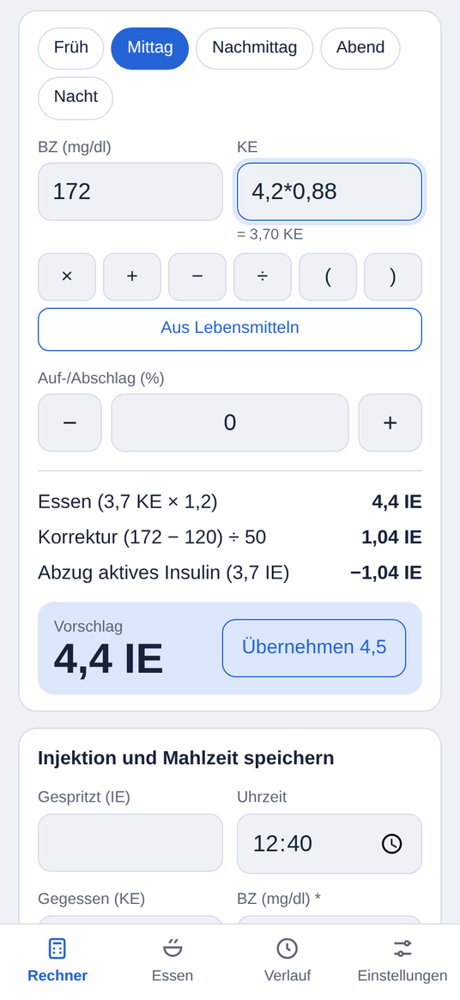
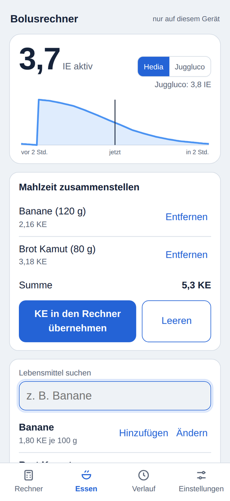
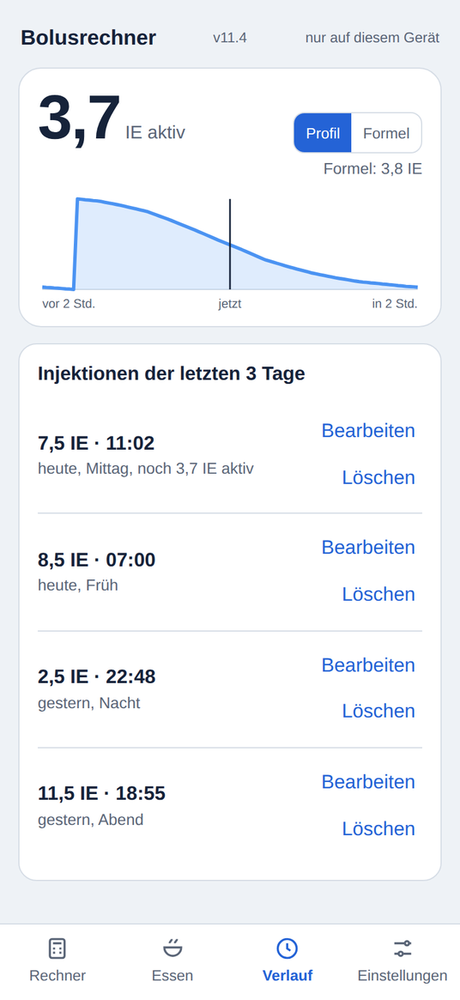
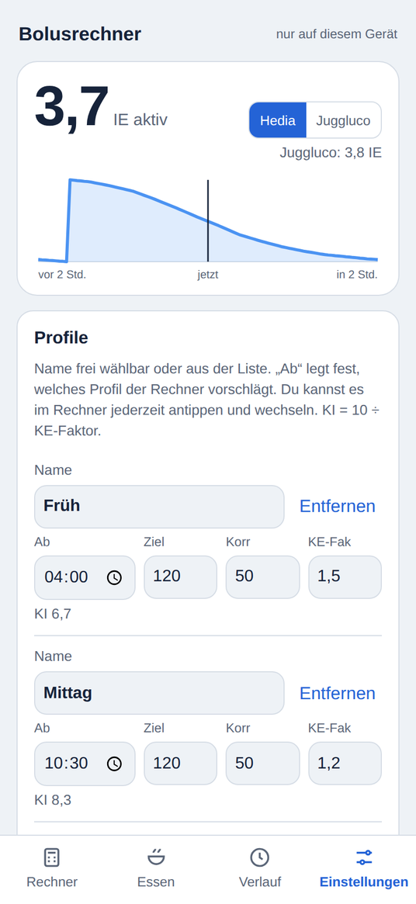

# Bolusrechner

Persönlicher Bolusrechner für Fiasp als Web-App für das iPhone. Läuft nach dem ersten Öffnen offline vom Home-Bildschirm.

> **Hinweis:** Eigenes Hilfsmittel für den privaten Gebrauch, **kein zugelassenes Medizinprodukt**.
> Alle Vorschläge vor der Anwendung prüfen und mit der eigenen Therapie bzw. dem Diabetes-Team abgleichen.

## Screenshots

| Rechner | Essen | Verlauf | Einstellungen |
|:---:|:---:|:---:|:---:|
|  |  |  |  |

*Beispieldaten: 7,5 IE Fiasp um 11:02, Abfrage um 12:40, BZ 172, KE als Formel `4,2*0,88`.*

## Funktionen

- **Bolusvorschlag** aus BZ, KE und Profil (BZ-Ziel, Korrekturfaktor, KE-Faktor)
  - aktives Insulin (IOB) wird nur vom Korrekturanteil abgezogen (wie Hedia)
  - zusätzlich: Vorschlag mit Auf-/Abschlag in % und Vorschlag minus gesamtes IOB
  - „Übernehmen“ rundet auf die kleinste Pen-Einheit (0,1 / 0,5 / 1 IE)
- **Aktives Insulin** mit Verlaufskurve (−2 bis +2 Std.)
  - Hedia-Profil: gemessene Werte, linear interpoliert, nach 240 Min. = 0
  - Juggluco-Formel als umschaltbare Alternative
- **Profile** frei benennbar, hinzufügen/entfernen, automatische Auswahl nach Uhrzeit
- **KE-Eingabe mit Formeln**, z. B. `4,2*0,88`
- **Lebensmittelliste**, Mahlzeiten-Korb und Rezeptrechner (KE pro Stück)
- **Sicherung** aller Daten als JSON-Datei (z. B. nach OneDrive), Wiederherstellen per Datei

## Dateien

| Datei | Zweck |
|---|---|
| `index.html` | die komplette App (HTML, CSS, JavaScript) |
| `sw.js` | Service Worker für den Offline-Betrieb |
| `manifest.webmanifest` | Name und Symbol für den Home-Bildschirm |
| `icon-*.png` | App-Symbole |
| `screenshots/` | Bilder für diese README (werden von der App nicht benötigt) |

## Veröffentlichen mit GitHub Pages

1. Repository auf GitHub anlegen (öffentlich) und alle Dateien hochladen.
2. **Settings → Pages → Source:** „Deploy from a branch“, Branch `main`, Ordner `/ (root)`.
3. Nach 1–2 Minuten erreichbar unter `https://<benutzername>.github.io/<repository>/`.
4. Auf dem iPhone in Firefox oder Safari öffnen → Teilen → **Zum Home-Bildschirm**.
5. Einmal vom Home-Bildschirm starten, danach funktioniert die App auch im Flugmodus.

## Neue Version veröffentlichen

1. Änderungen an `index.html` vornehmen.
2. In `index.html` die Versionsnummer erhöhen: `var APP_VERSION = "5";` → `"6"`.
   Sie wird oben in der App angezeigt und sorgt dafür, dass das iPhone die neue Fassung lädt
   (`sw.js` muss dafür nicht geändert werden).
3. Commit und Push. GitHub Pages aktualisiert die Seite automatisch.

## Lokal testen

Am einfachsten mit einem lokalen Webserver, da beim Öffnen per Doppelklick (`file://`)
Manifest und Service Worker nicht funktionieren:

- VS Code: Erweiterung **Live Server** → Rechtsklick auf `index.html` → „Open with Live Server“
- oder: `python -m http.server` im Projektordner, dann `http://localhost:8000`

iPhone-Größen in den Browser-Entwicklertools (F12 → Strg+Umschalt+M):
iPhone 17 = 402 × 874, iPhone XR = 414 × 896.

## Datenschutz

Alle Daten (Einstellungen, Injektionen, Lebensmittel) bleiben **nur im Browser des Geräts**.
Die App sendet nichts an einen Server. Sicherungsdateien (`bolusrechner-*.json`) gehören
**nicht** ins Repository und sind deshalb in `.gitignore` ausgeschlossen.

## Lizenz

MIT, siehe [LICENSE](LICENSE).
