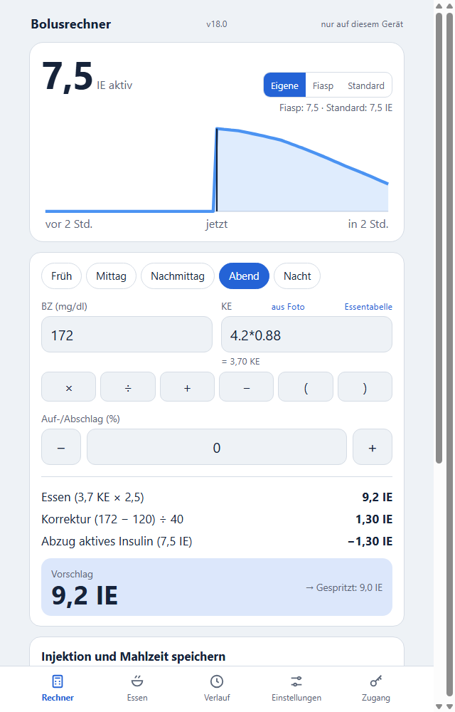
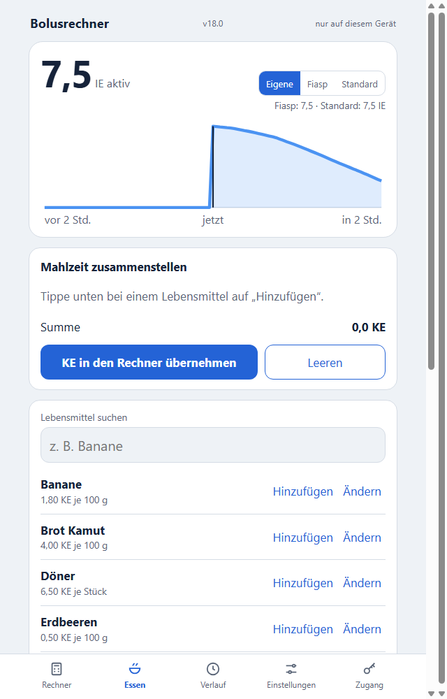
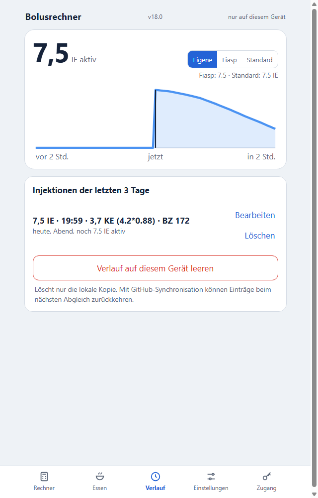
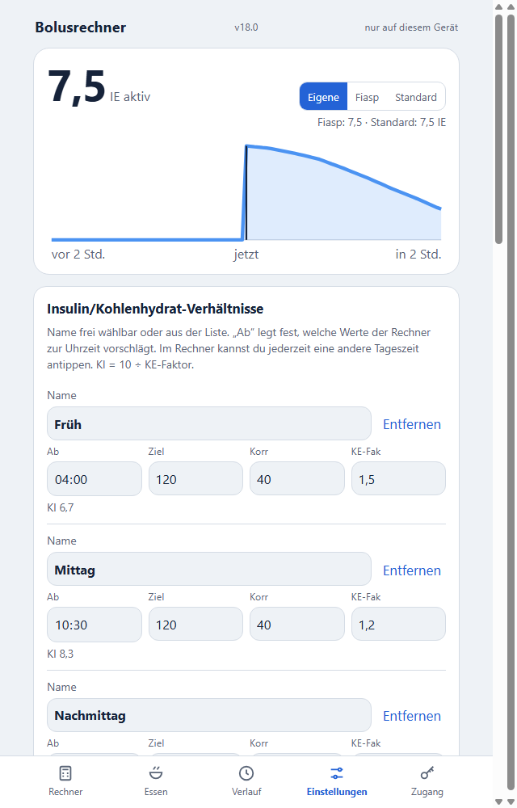
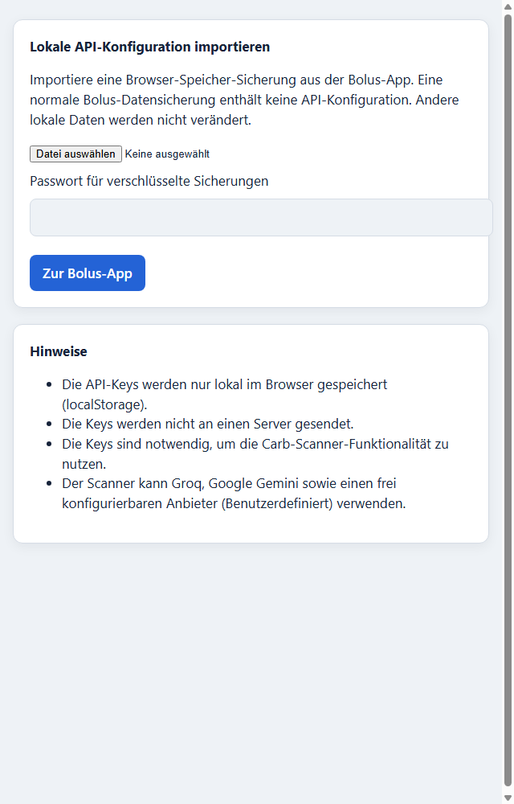
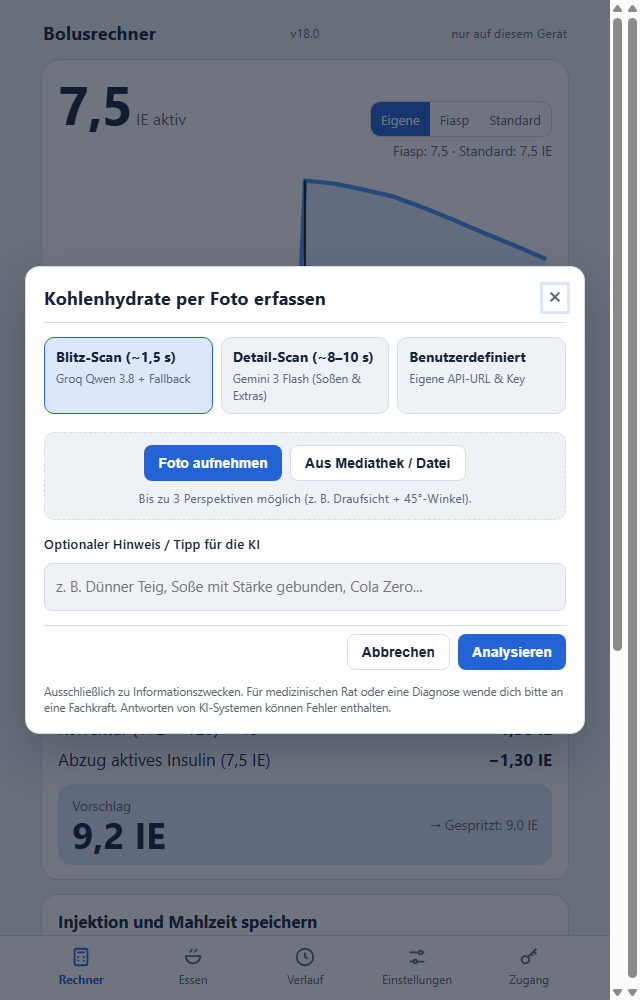

# Bolusrechner

Bolusrechner für schnell wirksames Insulin als Web-App für das iPhone. Läuft nach dem ersten Öffnen offline vom Home-Bildschirm.

> **Hinweis:** Eigenes Hilfsmittel für den privaten Gebrauch, **kein zugelassenes Medizinprodukt**.
> Alle Vorschläge vor der Anwendung prüfen und mit der eigenen Therapie bzw. dem Diabetes-Team abgleichen.

## Screenshots

| Rechner | Essen | Verlauf | Einstellungen |
|:---:|:---:|:---:|:---:|
|  |  |  |  |

*Die Bilder zeigen Beispieldaten, keine persönlichen Werte. Im Rechnerbeispiel: BZ 172 mg/dl und KE-Formel `4,2*0,88`.*

**Carb-API-Konfiguration importieren (Beispielseite):**



**Carb-Scanner im Rechner:** Neben **KE** auf **aus Foto** tippen, um den Dialog zu öffnen.



## Funktionen

- **Bolusvorschlag** aus BZ, KE und Profil (BZ-Ziel, Korrekturfaktor, KE-Faktor)
  - aktives Insulin (IOB) wird nur vom Korrekturanteil abgezogen (wie bei gängigen Bolusrechnern)
  - zusätzlich: Vorschlag mit Auf-/Abschlag in % und Vorschlag minus gesamtes IOB
  - „Übernehmen“ rundet auf die kleinste Pen-Einheit (0,1 / 0,5 / 1 IE)
- **Aktives Insulin** mit Verlaufskurve (−2 bis +2 Std.)
  - benutzerdefinierte Wirkkurve: gemessene Werte, linear interpoliert, nach 240 Min. = 0
  - Formel nach Juggluco für Fiasp
  - Standardmodell (wie Loop/OpenAPS) mit Vorlagen für Rapid- und Ultra-rapid-Insuline,
    Wirkmaximum und Wirkdauer einstellbar – für einen Insulinwechsel ohne eigene Messreihe
  - Umschalter „Eigene | Fiasp | Standard“, Vergleichstabelle aller drei Modelle in den Einstellungen
- **Insulin/Kohlenhydrat-Verhältnisse** je Tageszeit frei benennbar, hinzufügen/entfernen, automatische Auswahl nach Uhrzeit
- **KE-Eingabe mit Formeln**, z. B. `4,2*0,88`; verwendete Formeln werden mit dem Eintrag gespeichert, in der Historie angezeigt und auf andere Geräte synchronisiert
- **Lebensmittelliste**, Mahlzeiten-Korb und Rezeptrechner (KE pro Stück)
- **Carb-Scanner** zur Erkennung von Kohlenhydraten aus Fotos (Rechner → KE → „aus Foto“); dieselbe Scanner-Logik wird von der App und der [Beispielseite](app-beispiel-v3.html) verwendet
- **Verlauf** mit einstellbarer Aufbewahrung (Einstellungen → Verlauf, Standard 3 Tage, bis 365); „Verlauf auf diesem Gerät leeren“ löscht nur die lokale Kopie. Synchronisierte Einträge können beim nächsten Abgleich zurückkehren
- **Synchronisation** zwischen Geräten über ein privates GitHub-Repository (Tab **Zugang** – Zugangsdaten sind getrennt von den gesicherten Daten)
- **Glukose-Sensor** über eigenen REST-Dienst: Anzeige mit Trendpfeil, automatische Übernahme als BZ
- **Datensicherung** der App-Daten als JSON-Datei (z. B. nach OneDrive), Wiederherstellen per Datei
- **Browser-Speicher-Sicherung** optional verschlüsselt; daraus lassen sich auf der Beispielseite nur die Carb-API-Schlüssel übernehmen oder in der App die komplette lokale Konfiguration ersetzen

## Sicherung und Import

- **Normale Datensicherung** (Einstellungen → Sicherung) enthält App-Daten wie Einstellungen, Lebensmittel und Verlauf. API-Konfiguration und Zugangsdaten sind darin nicht enthalten.
- **Browser-Speicher-Sicherung** (Zugang → Lokaler Browser-Speicher) exportiert alle lokalen Speicherwerte einschließlich Carb-API-Schlüsseln und Synchronisations-Zugangsdaten. Mit einem Passwort wird die Sicherung verschlüsselt; ohne Passwort ist die JSON-Datei unverschlüsselt.
- **Selektiver Carb-Import:** `app-beispiel-v3.html` liest eine Browser-Speicher-Sicherung und übernimmt daraus nur die Carb-API-Konfiguration. Andere lokale Daten bleiben unverändert. Eine normale Datensicherung enthält diese Schlüssel nicht.
- **Kompletter Import:** Die Wiederherstellung des Browser-Speichers in der App ersetzt den gesamten lokalen Speicher dieses Geräts. Dabei werden bestehende Einträge und Zugangsdaten durch die Inhalte der Sicherung ersetzt.

## Synchronisation zwischen Geräten (GitHub)

Die App kann ihre Daten automatisch über ein **zweites, privates** Repository abgleichen
(z. B. Smartphone ↔ Zweitgerät ↔ PC). Jedes Gerät behält eine lokale Kopie und funktioniert offline;
Änderungen werden hochgeladen, sobald wieder Internet da ist.

### Einmalig einrichten

1. **Privates Daten-Repository anlegen:** GitHub → „+“ → *New repository*, Name z. B. `bolus-daten`,
   Sichtbarkeit **Private**, Haken bei *Add a README file*.
2. **Token erstellen** – siehe [Token generieren](#token-generieren) weiter unten.
3. **In der App:** Tab **Zugang** (Schlüssel-Symbol) → *Synchronisation (GitHub)* → Repository `benutzername/bolus-daten`
   und Token eintragen → **Verbinden**. Auf jedem Gerät wiederholen (gleicher oder eigener Token).

### Token generieren

Der Token ist der Zugangsschlüssel der App zum Daten-Repository. Er darf **nur dieses eine
Repository** lesen und schreiben.

1. Auf GitHub oben rechts auf das **Profilbild** → **Settings**.
2. Links ganz unten **Developer settings** → **Personal access tokens** → **Fine-grained tokens**.
3. **Generate new token** (ggf. Passwort bzw. Zwei-Faktor-Code bestätigen).
4. Angaben ausfüllen:
   - **Token name:** z. B. `Bolusrechner`
   - **Description** (optional): z. B. `Sync Smartphone, Zweitgerät, PC`
   - **Resource owner:** dein eigenes Konto
   - **Expiration:** z. B. **366 days** (siehe [Ablaufdatum](#ablaufdatum-und-erneuerung))
5. **Repository access:** **Only select repositories** wählen und im Auswahlfeld
   **nur** `bolus-daten` auswählen.
6. **Permissions** (Berechtigungen):
   1. Unter *Repository permissions* auf **Add permissions** klicken.
   2. In der Liste den Haken bei **Contents** setzen (oder „Contents“ ins Suchfeld tippen)
      und die Liste mit einem Klick daneben schließen.
   3. In der neuen Zeile **Contents** rechts das Auswahlfeld von *Read-only* auf
      **Read and write** umstellen.
   4. Die Zeile **Metadata: Read-only** erscheint automatisch und bleibt so.
   5. Keine weiteren Berechtigungen hinzufügen.
7. Unten **Generate token** → kontrollieren, dass in der Übersicht *Contents: Read and write*
   und *Metadata: Read-only* für `bolus-daten` stehen → **Generate token** bestätigen.
8. Den angezeigten Token (`github_pat_…`) **sofort kopieren** – er wird nur dieses eine Mal angezeigt.
   Am besten direkt in die App eintragen; zum Aufbewahren nur in einem Passwort-Manager,
   **nicht** in Notizen, Mails oder im Repository.

> Ein Token kann auf mehreren Geräten verwendet werden. Wer es übersichtlicher mag,
> erstellt pro Gerät einen eigenen Token (z. B. `Bolusrechner Smartphone`, `… PC`) –
> dann lässt sich bei Verlust gezielt nur einer löschen.

### Ablaufdatum und Erneuerung

- Ein Ablaufdatum begrenzt den Schaden, falls ein Token unbemerkt in falsche Hände gerät.
  1 Jahr ist ein guter Kompromiss zwischen Sicherheit und Aufwand.
- GitHub schickt einige Tage vor Ablauf eine **Erinnerungs-E-Mail**.
- Nach Ablauf läuft die App normal weiter, nur der Abgleich stoppt
  (Tab Zugang: „Token ungültig oder abgelaufen“, oben: „Sync-Fehler“). Es gehen keine Daten verloren.
- Erneuern: neuen Token wie oben erstellen (oder beim alten Token **Regenerate token**),
  auf jedem Gerät in der App eintragen → **Verbinden**.

### Token sperren (z. B. bei Verlust eines Geräts)

Profilbild → Settings → Developer settings → Personal access tokens → Fine-grained tokens →
Token auswählen → **Delete**. Danach auf den übrigen Geräten ggf. einen neuen Token eintragen.

### So wird abgeglichen

- Solange der Abgleich funktioniert, entfällt die Erinnerung an die manuelle Sicherung.

- Beim Start, beim Zurückkehren in die App, nach jeder Änderung und alle 2 Minuten.
- **Injektionen** werden zusammengeführt; gelöschte Einträge werden auf allen Geräten gelöscht.
- **Einstellungen** und **Lebensmittel**: die zuletzt geänderte Fassung gewinnt.
- Die Daten liegen als `bolus-daten.json` im Daten-Repository; jede Änderung ist ein Commit
  (dadurch gibt es dort auch eine Versionsgeschichte).
- Der Token bleibt nur auf dem Gerät und ist **nicht** in der JSON-Sicherung enthalten.
- Bei Verlust eines Geräts: Token unter *Fine-grained tokens* löschen.

> Das App-Repository bleibt öffentlich, das Daten-Repository muss **privat** sein.
> Die App warnt, wenn das Daten-Repository öffentlich ist.

## Glukose-Sensor (eigener REST-Dienst)

Optional kann die App den aktuellen Sensorwert (z. B. Dexcom G7) von einem **eigenen REST-Dienst**
abrufen. Er erscheint oben im IOB-Kasten (Wert, Trendpfeil, Uhrzeit) und wird als BZ in den Rechner
übernommen – überschreibbar, z. B. nach einer blutigen Messung.

**Einrichtung:** Tab **Zugang** → *Glukose-Sensor (REST-API)* → URL, Timeout (Standard 60 s),
Polling-Intervall (Standard 150 s) und optional **API-Schlüssel** → **Speichern & testen**.
Diese Angaben bleiben nur auf dem Gerät.

**API-Schlüssel (optional):** Ist einer eingetragen, sendet die App ihn als Header `X-Api-Key`.
Bleibt das Feld leer, wird kein Header gesendet. Der Dienst sollte dann `X-Api-Key` in
`Access-Control-Allow-Headers` erlauben und Vorabanfragen (`OPTIONS`) mit 204 beantworten.

**Erwartete Antwort (JSON):**
```json
{ "success": true, "value": 112, "trend": "fortyfiveup", "time": 1792999887923 }
```
`time` in Millisekunden seit 1.1.1970; `trend`: `flat`, `singleup`, `doubleup`, `fortyfiveup`,
`singledown`, `doubledown`, `fortyfivedown`.

**Abruf:** beim Start, beim Zurückkehren in die App, im eingestellten Intervall und per Antippen der Anzeige.
Werte älter als 15 Minuten werden grau dargestellt und nicht mehr in den Rechner übernommen.

**Voraussetzungen auf Seite des Dienstes:**
- erreichbar über **https**
- **CORS** erlaubt: Antwort-Header `Access-Control-Allow-Origin: https://<benutzername>.github.io`
  (oder `*`) – sonst blockiert der Browser die Antwort („keine Verbindung (Internet oder CORS)“).
- Kostenlose render.com-Dienste schlafen nach Inaktivität ein; der erste Abruf kann bis zu einer
  Minute dauern (daher der Timeout von 60 s).

## Dateien

| Datei | Zweck |
|---|---|
| `index.html` | App-Struktur und Bereiche |
| `app.js` | Rechner, Verlauf, Synchronisation und App-Verhalten |
| `storage.js` | lokales Speichern, Carb-API-Konfiguration und Backup-Import |
| `bolus-theme.css` | gemeinsames Erscheinungsbild für App und Beispielseite |
| `carb-scanner-v3.js` | wiederverwendbare Carb-Scanner-Logik |
| `carb-dialog-v3.html` | Dialog des Carb-Scanners |
| `app-beispiel-v3.html` | Integration des Scanners und selektiver Import der Carb-API-Konfiguration |
| `sw.js` | Service Worker und Precache für den Offline-Betrieb |
| `manifest.webmanifest` | Name und Symbol für den Home-Bildschirm |
| `icon-*.png` | App-Symbole |
| `screenshots/` | Bilder für diese README (werden von der App nicht benötigt) |

## Veröffentlichen mit GitHub Pages

1. Repository auf GitHub anlegen (öffentlich) und alle Dateien hochladen.
2. **Settings → Pages → Source:** „Deploy from a branch“, Branch `main`, Ordner `/ (root)`.
3. Nach 1–2 Minuten erreichbar unter `https://<benutzername>.github.io/<repository>/`.
4. Auf dem iPhone in Firefox oder Safari öffnen → Teilen → **Zum Home-Bildschirm**.
5. Einmal vom Home-Bildschirm starten, danach funktioniert die App auch im Flugmodus.

## Neue Version veröffentlichen

1. Die Änderung in der passenden Datei vornehmen (`index.html`, `app.js`, `storage.js` oder den Carb-Dateien).
2. `APP_VERSION` in `app.js` für die Veröffentlichung erhöhen (aktuell `18.0`). Der Wert wird auch an den Service Worker übergeben und erzeugt einen neuen Offline-Cache.
3. Werden Offline-Dateien hinzugefügt oder entfernt, die Precache-Liste `FILES` in `sw.js` entsprechend anpassen.
4. Commit und Push auf den von GitHub Pages verwendeten Branch. Pages veröffentlicht die neue Fassung automatisch.

## Lokal testen

Am einfachsten mit einem lokalen Webserver, da beim Öffnen per Doppelklick (`file://`)
Manifest und Service Worker nicht funktionieren. Die App muss über HTTPS oder `localhost` geöffnet werden:

- VS Code: Erweiterung **Live Server** → Rechtsklick auf `index.html` → „Open with Live Server“
- oder: `python -m http.server 3000` im Projektordner, dann `http://localhost:3000`

iPhone-Größen in den Browser-Entwicklertools (F12 → Strg+Umschalt+M):
iPhone 17 = 402 × 874, iPhone XR = 414 × 896.

Für einen iPhone-Test über das Notebook muss die App über eine HTTPS-Adresse erreichbar sein, deren Zertifikat das iPhone vertraut. `localhost` auf dem iPhone bezeichnet das iPhone selbst, nicht das Notebook.

## Datenschutz

Einstellungen, Verlauf, Lebensmittelliste und API-Konfiguration liegen im Browser des Geräts.
Wenn die GitHub-Synchronisation eingerichtet ist, werden App-Daten zusätzlich in **dein privates
Daten-Repository** geschrieben. Beim Carb-Scan wird das ausgewählte Foto an den konfigurierten API-Anbieter gesendet; prüfe dessen Datenschutzbedingungen.

Die normale JSON-Datensicherung enthält keine API- oder Synchronisations-Zugangsdaten. Die Browser-Speicher-Sicherung enthält dagegen alle lokalen Speicherwerte. Ohne gesetztes Passwort ist sie unverschlüsselt; verschlüssele sie vor dem Ablegen oder Teilen. Sicherungsdateien (`bolusrechner-*.json` und `.bolusenc`) gehören **nicht** ins Repository und sind deshalb in `.gitignore` ausgeschlossen.

## Lizenz

MIT, siehe [LICENSE](LICENSE).
